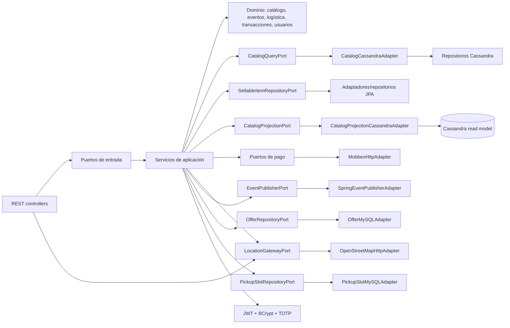
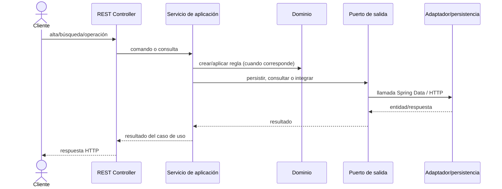
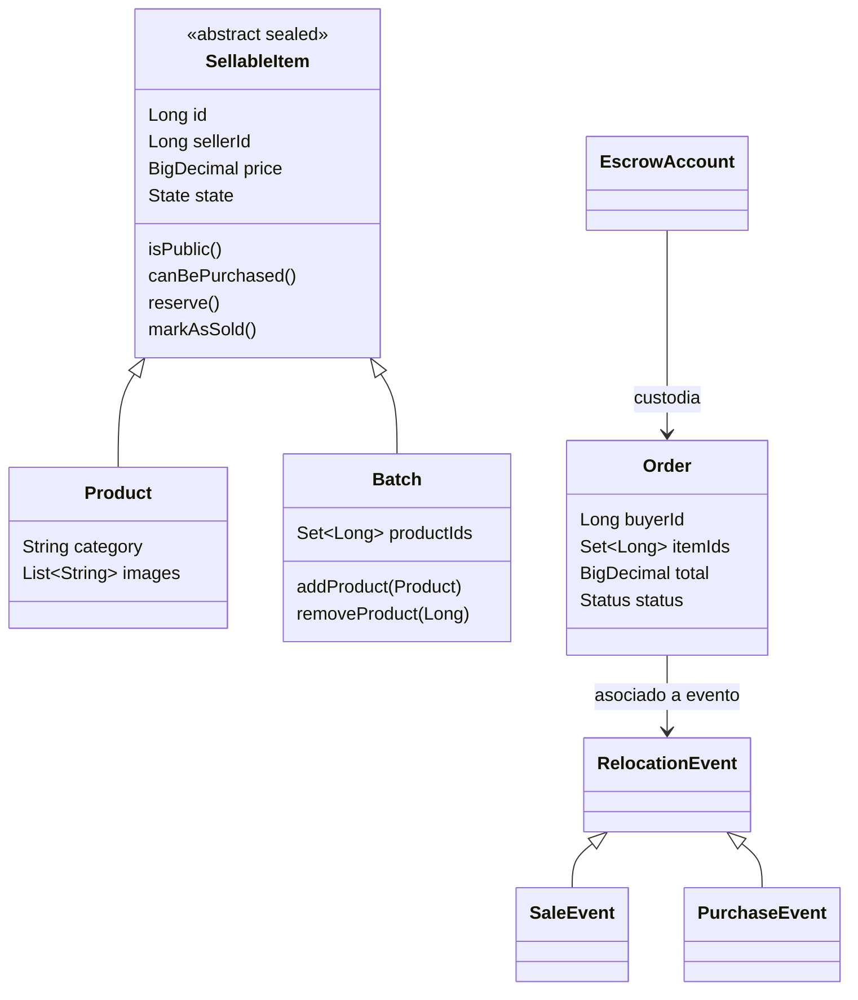
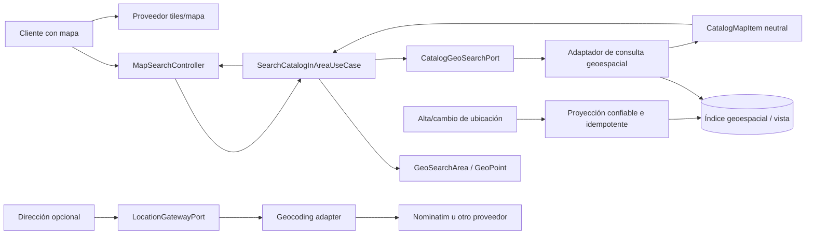

# Diagramas de arquitectura

Los diagramas reflejan el código entregado y marcan como propuesta cualquier componente futuro.

## Componentes actuales



Nota: el acceso directo de `SearchCatalogService` a repositorios Cassandra y las entidades Cassandra expuestas por contratos de aplicación son desviaciones del límite esperado, no flechas de una arquitectura ideal.

## Interacciones principales observadas



Para cercanía en particular, el caso `FindNearbyCatalogService` resuelve zona mediante `LocationGatewayPort`, obtiene una lista de zonas y solicita artículos/cajas por zona a `CatalogQueryPort`. El adaptador incluido de OpenStreetMap responde hoy solo con la zona central ante consulta de zonas cercanas.

## Relaciones principales de dominio



El diagrama resume relaciones observables y no implica que las entidades JPA tengan el mismo grafo: el proyecto separa modelos de dominio y entidades de infraestructura.

## DER relacional inferido de anotaciones JPA

No se encontraron migraciones SQL/DDL en el paquete revisado. El diagrama refleja las tablas y `@CollectionTable` configuradas en JPA; las relaciones de colección son inferidas desde `joinColumns`. Las columnas de ID escalares (`orders.buyer_id`, `orders.event_id`, `orders.slot_id`, `disputes.order_id`, `disputes.buyer_id`, `pickup_slots.order_id`, `sellable_items.seller_id`) no están mapeadas como `@ManyToOne` ni declaran `@ForeignKey`, así que no se presentan como FK confirmadas. La estrategia de artículos/lotes es `SINGLE_TABLE` con discriminador.

```mermaid
erDiagram
  USERS {
    bigint id PK
    string email
    string password_hash
    string account_status
    string user_role
  }
  USER_TWO_FACTOR_RECOVERY_CODES {
    bigint user_id FK
    string code_hash
  }
  RELOCATION_EVENTS {
    bigint id PK
    bigint user_id
    string event_type
    string status
    string share_token UK
  }
  RELOCATION_EVENT_DISCOUNT_RULES {
    bigint event_id FK
    int rule_order
    int days_left
    decimal percentage
  }
  RELOCATION_EVENT_SHARED_USERS {
    bigint event_id FK
    bigint user_id
  }
  RELOCATION_EVENT_ITEMS {
    bigint event_id FK
    bigint item_id
  }
  SELLABLE_ITEMS {
    bigint id PK
    bigint seller_id
    string item_type
    decimal price
    string state
  }
  PRODUCT_IMAGES {
    bigint product_id FK
    string image_url
  }
  BATCH_PRODUCTS {
    bigint batch_id FK
    bigint product_id
  }
  ORDERS {
    bigint id PK
    bigint event_id nullable
    bigint buyer_id
    decimal total
    string origin
    string status
  }
  SHOPPING_CARTS {
    bigint buyer_id PK
  }
  SHOPPING_CART_ITEMS {
    bigint buyer_id FK
    bigint item_id
  }
  ORDER_ITEMS {
    bigint order_id FK
    bigint item_id
  }
  ESCROW_ACCOUNTS {
    bigint order_id PK
    decimal amount
    string status
    string external_operation_id UK
  }
  DISPUTES {
    bigint id PK
    bigint order_id
    bigint buyer_id
    string status
    datetime evidence_requested_at
  }
  DISPUTE_EVIDENCE {
    bigint dispute_id FK
    string image_url
  }
  PICKUP_SLOTS {
    bigint id PK
    bigint order_id
    datetime start_time
    datetime end_time
    boolean buyer_confirmed
    boolean seller_confirmed
  }
  OFFERS {
    bigint id PK
    bigint item_id
    bigint buyer_id
    decimal amount
    string status
  }

  USERS ||--o{ USER_TWO_FACTOR_RECOVERY_CODES : element_collection
  RELOCATION_EVENTS ||--o{ RELOCATION_EVENT_DISCOUNT_RULES : element_collection
  RELOCATION_EVENTS ||--o{ RELOCATION_EVENT_SHARED_USERS : element_collection
  RELOCATION_EVENTS ||--o{ RELOCATION_EVENT_ITEMS : element_collection
  SELLABLE_ITEMS ||--o{ PRODUCT_IMAGES : element_collection
  SELLABLE_ITEMS ||--o{ BATCH_PRODUCTS : element_collection
  ORDERS ||--o{ ORDER_ITEMS : element_collection
  SHOPPING_CARTS ||--o{ SHOPPING_CART_ITEMS : element_collection
  DISPUTES ||--o{ DISPUTE_EVIDENCE : element_collection
```

`ESCROW_ACCOUNTS.order_id` is a shared identifier by convention but the inspected entity does not declare a JPA relationship to `ORDERS`; `PICKUP_SLOTS.order_id` similarly remains a scalar. Cassandra catalog tables are read projections and are intentionally excluded from this relational DER.

## Arquitectura propuesta para búsqueda en mapa (no implementada)



El proveedor de tiles sirve la capa visual; el backend consulta publicaciones propias. La búsqueda propuesta no se debe confundir con la resolución de zonas ya presente.
