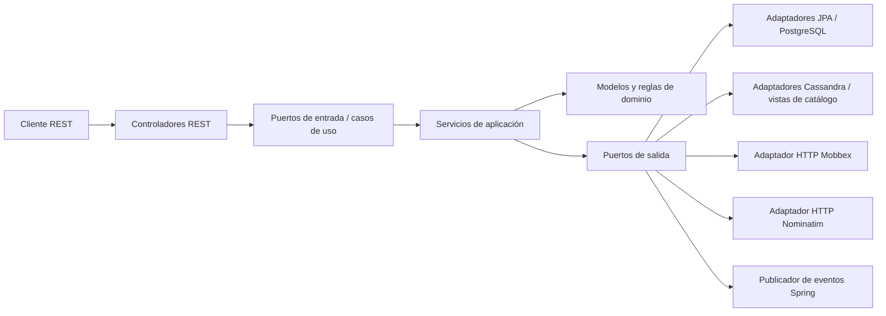

# Arquitectura de Muvix

## Propósito y dominio

Muvix combina un marketplace de productos/lotes de segunda mano con gestión de cajas/eventos de mudanza, coordinación de retiros y custodia de pagos. Los conceptos centrales observables son `SellableItem` (`Product` y `Batch`), eventos de venta/compra/mudanza, `Order`, `EscrowAccount`, usuarios y zonas de ubicación. El precio cero representa un artículo privado; las reglas de disponibilidad y reserva viven en `SellableItem`.

## Stack y build

- Java 21; Maven; Spring Boot 4.1.2 (según el `pom.xml` recibido).
- Spring MVC, Validation, Security, Spring Data JPA, Spring Data Cassandra.
- PostgreSQL como driver/runtime declarado; Cassandra para lecturas de catálogo.
- MapStruct y Lombok declarados. No se observa configuración de base ni migraciones en los archivos entregados.
- Integraciones HTTP con Mobbex y OpenStreetMap/Nominatim, además de eventos Spring.

El paquete entregado incluye `src/`, `pom.xml` y únicamente `maven-wrapper.properties`; no incluye wrapper ejecutable, scripts, README, archivos de migración ni infraestructura de despliegue.

## Estilo arquitectónico

La intención es Ports and Adapters (hexagonal): `application.port.in` define entradas de casos de uso, `application.port.out` define dependencias externas y `infrastructure.adapters` implementa controladores REST, persistencia e integraciones. El dominio está en `domain.model`. Esto se cumple parcialmente: por ejemplo, `BrowseCatalogService` depende de un puerto pero devuelve una entidad Cassandra; `CatalogQueryPort` también expone entidades de infraestructura, y `SearchCatalogService` accede directamente a repositorios Spring Data. Hay filtrado y ordenamiento duplicados entre `FilterCatalogService` y `SearchCatalogService`.

## Organización y responsabilidades

| Área | Responsabilidad observada |
|---|---|
| `domain.model.catalogue` | Artículos, lotes, estados y reglas de disponibilidad/venta. |
| `domain.model.transaction` | Pedido, disputa y custodia. |
| `domain.model.management` | Eventos de compra, venta, mudanza y precios. |
| `application.port.in` | Contratos de casos de uso y comandos/consultas. |
| `application.usecase` | Coordinación de dominio, puertos e integraciones. |
| `application.port.out` | Persistencia, pagos, ubicación, seguridad y publicación de eventos. |
| `infrastructure.adapters.in.rest` | API HTTP, DTOs, mapeadores y manejo de excepciones. |
| `infrastructure.adapters.out.persistence.mysql` | Repositorios/adaptadores y mapeo JPA. |
| `infrastructure.adapters.out.persistence.cassandra` | Vistas de lectura por zona y repositorios Cassandra. |
| `infrastructure.adapters.out.payment`, `location`, `event` | Adaptadores Mobbex, Nominatim y eventos Spring. |
| `infrastructure.config`, `scheduler` | Configuración Spring y liberación programada de escrow. |

## Componentes principales y flujo

El recorrido del feed es `BrowseCatalogUseCase` → `BrowseCatalogService` → `CatalogQueryPort` → `CatalogCassandraAdapter` → repositorio Cassandra. El alta pública observada es `CreateProductService` → creación de dominio → puerto de artículos → proyección del modelo de lectura Cassandra. El flujo de cercanía está en `FindNearbyCatalogService`: geocodifica coordenadas, obtiene zonas, consulta artículos/cajas por zona y construye la respuesta. La ubicación concreta se llama a través de `LocationGatewayPort`.

## Persistencia e integraciones

JPA/MySQL (aunque el POM declara PostgreSQL) almacena entidades de negocio transaccionales, y Cassandra ofrece consultas de catálogo particionadas por `zone`. Esa separación tiene forma de CQRS/proyección, pero no se puede confirmar consistencia, esquema, ni ciclo de proyección: faltan el adaptador que implemente `CatalogProjectionPort`, configuración útil y scripts de esquema en el material recibido. `OpenStreetMapHttpAdapter` implementa resolución inversa mediante Nominatim; hoy `findNearbyZones` devuelve solo la zona central. Mobbex se abstrae mediante puertos de pago y hay una factoría de gateway.

## Patrones observados

- Ports and Adapters parcial: contratos de entrada/salida y adaptadores.
- Repository: puertos de persistencia más Spring Data.
- Adapter: Mobbex, OpenStreetMap y publicador Spring.
- Factory: `EscrowGatewayFactory`.
- Domain Events: eventos del dominio y publicador Spring.
- CQRS/proyección: separación de escritura relacional y lectura Cassandra (incompleta en los archivos entregados).

Para el diagrama de relaciones y flujos complementarios, ver [ARCHITECTURE_DIAGRAMS.md](ARCHITECTURE_DIAGRAMS.md).
