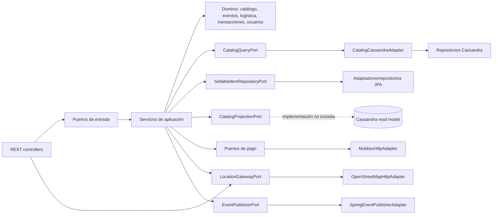
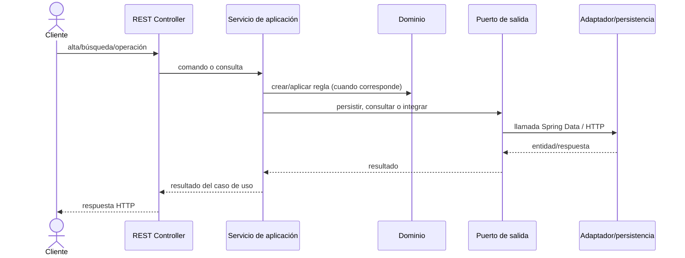
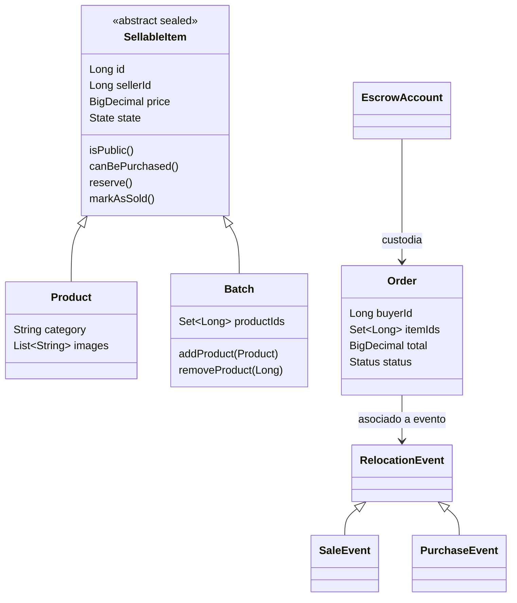
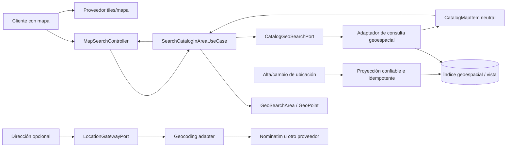

# Diagramas de arquitectura

Los diagramas reflejan el código entregado y marcan como propuesta cualquier componente futuro.

## Componentes actuales

Nota: el acceso directo de `SearchCatalogService` a repositorios Cassandra y las entidades Cassandra expuestas por contratos de aplicación son desviaciones del límite esperado, no flechas de una arquitectura ideal.

## Interacciones principales observadas

Para cercanía en particular, el caso `FindNearbyCatalogService` resuelve zona mediante `LocationGatewayPort`, obtiene una lista de zonas y solicita artículos/cajas por zona a `CatalogQueryPort`. El adaptador incluido de OpenStreetMap responde hoy solo con la zona central ante consulta de zonas cercanas.

## Relaciones principales de dominio

El diagrama resume relaciones observables y no implica que las entidades JPA tengan el mismo grafo: el proyecto separa modelos de dominio y entidades de infraestructura.

## Arquitectura propuesta para búsqueda en mapa (no implementada)

El proveedor de tiles sirve la capa visual; el backend consulta publicaciones propias. La búsqueda propuesta no se debe confundir con la resolución de zonas ya presente.
