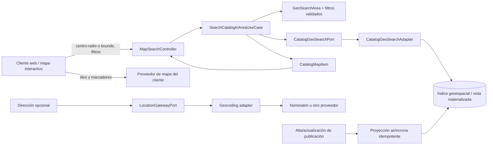

# Análisis de impacto: búsqueda de catálogo en mapa

## Requisito y alcance

Permitir explorar publicaciones y cajas relevantes sobre una vista geográfica interactiva, con búsqueda por área y/o radio, marcadores y filtros. Debe soportar futuros proveedores cartográficos. **La búsqueda interactiva en mapa no fue implementada**, tal como exige la consigna: este documento es una propuesta arquitectónica.

El código ya resuelve coordenadas a `ZoneDetail`, expone `/api/v1/locations/nearby-zones` y posee `FindNearbyCatalogUseCase`. Eso es geocodificación y consulta aproximada por zonas, no un mapa interactivo ni una búsqueda geoespacial precisa: `OpenStreetMapHttpAdapter.findNearbyZones` actualmente devuelve solo la zona central, y los registros de catálogo Cassandra no almacenan coordenadas. La propuesta respeta estas diferencias; no describe la capacidad como ya existente.

## Impacto real y cambios requeridos

| Componente existente | Impacto | Justificación |
|---|---|---|
| `LocationController` | Modificar o sumar controlador de búsqueda | `/resolve-zone` y `/nearby-zones` cubren zonas, no consulta de publicaciones con filtros/mapa. La nueva API debería expresar un área/radio y paginación. |
| `FindNearbyCatalogUseCase` / `FindNearbyCatalogService` | Evolucionar o agregar caso de uso dedicado | Hoy consulta zonas devueltas por gateway y concatena resultados; no aplica distancia a cada publicación ni criterios de búsqueda de mapa. Separar nuevo contrato evita cambiar semántica de callers actuales. |
| `LocationGatewayPort` | Mantener para geocodificación; no convertirlo en proveedor de mapa UI | Un mapa cliente no requiere que backend renderice tiles. Solo geocoding/normalización externa merece puerto de ubicación. |
| `CatalogQueryPort` | Agregar capacidad de búsqueda por área/radio, filtros y paginación si Cassandra es fuente elegida | El puerto actual solo ofrece lecturas por zona y entidades de infraestructura. Conviene también desacoplar modelos Cassandra (hallazgo de auditoría). |
| `CatalogItemCassandraEntity` y `PublicBoxCassandraEntity` | Incluir ubicación publicable o resolverla desde un índice auxiliar | Solo guardan `zone`, no latitud/longitud. No almacenar dirección exacta en payload público. |
| Adaptador y schema Cassandra | Nueva consulta/tabla materializada por geocelda, geohash o tesela; no basta el `WHERE zone` actual | Cassandra modela consultas mediante particiones conocidas y no debe resolver una búsqueda radial global por `ALLOW FILTERING`. |
| DTO API / validación | Nuevos request/response con bounds o centro/radio, filtros y coordenadas de marcador aproximadas | Validar latitud [-90,90], longitud [-180,180], radio acotado, paginación y límites de área. El DTO HTTP no debe ser entidad Cassandra. |
| Seguridad y privacidad | Revisión necesaria | No exponer dirección exacta del vendedor; limitar precisión y frecuencia de consultas. Los archivos no aportan políticas completas para concluir más. |
| Integración externa | Opcional | Leaflet/OpenStreetMap u otro cliente puede renderizar el mapa. Backend solo necesita geocodificador si el usuario introduce una dirección, y mantenerlo tras un puerto. |

No es necesario cambiar `SellableItem` con coordenadas si la ubicación pertenece al punto de retiro/caja y no al artículo. Si el dominio confirma que cada anuncio puede tener ubicación independiente, modelar `PickupLocation` o `GeoPoint` como valor del agregado dueño, en vez de añadir campos globales sin semántica.

## Arquitectura propuesta

### Contratos y modelos nuevos (propuestos)

- `SearchCatalogInAreaUseCase`: caso de uso con criterios `center + radius` o `bounding box`, filtros, orden y cursor/página.
- `GeoPoint` como valor inmutable con validación de coordenadas; `GeoSearchArea` define un radio o rectángulo. Elegir radio o bounds según UX/API; aceptar ambos solo si se necesita de verdad.
- `CatalogGeoSearchPort`: puerto de salida que consulta publicaciones/cajas dentro del área y devuelve `CatalogMapItem` neutral a persistencia, con lat/lon aproximados y datos mínimos de marcador.
- `CatalogGeoSearchAdapter`: implementación sobre índice geoespacial/materialización apropiada. `CatalogQueryPort` podría evolucionar en vez de sumar puerto si el dueño de consultas determina que es la misma responsabilidad.
- DTOs REST separados, por ejemplo `MapSearchRequest` y `MapSearchResponse`; no incluir entidad Cassandra ni dirección residencial.
- Un cliente cartográfico es una decisión de presentación. Para frontend web, un adaptador de proveedor de mapas puede ocultar diferencias de API, pero no pertenece al dominio/backend.

### Diagrama de componentes

## Interacciones previstas

1. Cliente envía centro y radio, o bounds del viewport, filtros y cursor.
2. Controller valida sintaxis/autorización y traduce el DTO a consulta de aplicación.
3. Caso de uso valida rango y coordina política de visibilidad y puerto geográfico. Las reglas del dominio deciden qué publicaciones son públicas/comprables; la API no debe revelar direcciones exactas.
4. Adaptador consulta índice geoespacial por particiones/teselas y aplica precisión y orden/paginación acordados; devuelve proyección neutral al caso de uso.
5. Controller serializa respuesta con marcadores y datos resumidos. El cliente solicita tiles a proveedor de mapas directamente, salvo requisito de proxy explícito.
6. La creación/cambio de ubicación actualiza la vista geoespacial de forma fiable (outbox/reintentos) o dentro de estrategia de persistencia transaccional que se elija.

## Decisiones, patrones, SOLID y GRASP

- **Adapter:** encapsula formato/protocolo del motor geoespacial, geocoder o proveedor de mapas; evita tipos de terceros en casos de uso.
- **Repository/port:** expresa consulta que la aplicación necesita, no la tabla específica.
- **Specification (opcional):** solo conviene si filtros componibles crecerán; para pocos filtros un objeto criterio simple basta.
- **Strategy (opcional):** útil para alternar motores de geocoding/índice o proveedores de mapas. No se necesita si hay una sola implementación estable; configuración Spring con puerto implementado puede bastar.
- **SOLID:** DIP protege aplicación del motor/proveedor; OCP permite sumar adaptador; SRP mantiene HTTP, reglas de búsqueda y consultas separadas; ISP sugiere no inflar el puerto general de catálogo con funciones no relacionadas.
- **GRASP:** Controller asigna coordinación al caso de uso; Information Expert conserva disponibilidad/visibilidad en el dominio; Pure Fabrication justifica adaptador/índice para detalles técnicos; Low Coupling/Protected Variations se logran con puertos y modelos independientes.

## Costo, riesgos y migración

Estimación inicial de tamaño: **medio/alto**, condicionada por volumen, UX y datos actuales. Diseño/decisiones (área, privacidad, paginación): 2–4 días; modelo de ubicación, índice y proyección/migración: 4–10 días; API y cliente de mapa: 3–8 días; pruebas de límites, privacidad, rendimiento y consistencia: 3–6 días. Son rangos de planificación, no compromiso; experiencia actual y DDL no fueron provistos.

Riesgos: coordenadas ausentes o imprecisas; exponer domicilios; índice desactualizado; particiones calientes o escaneo caro; límites/cuotas de geocoder; sesgo/errores de geocodificación; abuso de API; duplicados en bordes de tesela; incompatibilidad de nuevos DTOs. Migración sugerida: decidir dueño/precisión de ubicación; agregar esquema y backfill solo desde origen autorizado; desplegar proyección idempotente; validar conteos/consultas; publicar endpoint versionado; habilitar cliente gradualmente; retirar consultas por zona solo después de compatibilidad confirmada.

No se deben guardar coordenadas privadas ni enviar al proveedor externo datos personales innecesarios. La selección de proveedor, motor geoespacial, presupuesto de cuotas y política de retención requieren decisiones de producto/operaciones.
